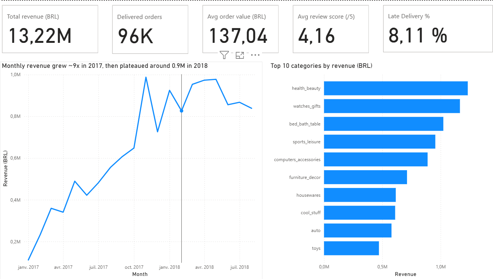
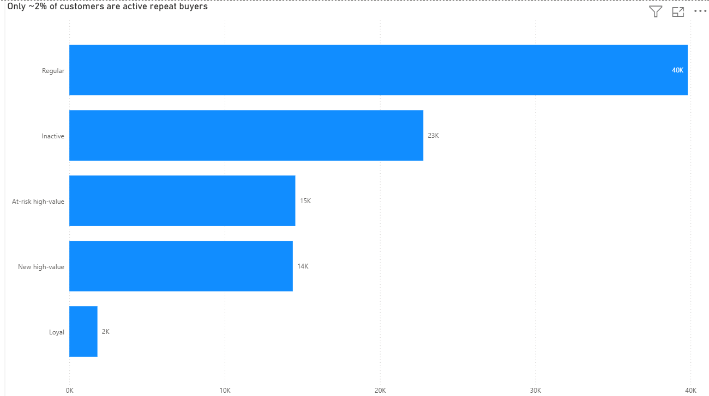

# Olist E-commerce Analysis: SQL, Python & Power BI

An end-to-end analysis of the Brazilian Olist e-commerce dataset (about 96K delivered orders, 2017-2018). I extracted the data with **MySQL**, cleaned and explored it with **Python (pandas)**, and built a 3-page **Power BI** dashboard with findings and recommendations.


## Key findings

1. **Late deliveries are strongly associated with low review scores.** Late orders average **2.57** vs **4.29** for on-time orders (-40%). Scores fall from 4.3 (early) to 3.3 (1-3 days late), 2.1 (4-7 days late) and 1.7 beyond one week.
2. **Almost no customers come back.** **97.0%** of customers placed a single order; only 3.0% ordered twice or more.
3. **Revenue growth stalled in 2018.** Monthly revenue grew about 9x during 2017 (0.11M in January to 0.99M in November, the Black Friday peak), then plateaued around 0.85M-0.98M.

Full write-up with recommendations: [docs/summary.md](docs/summary.md)

## Dashboard

| Overview | Delivery & satisfaction | Customers (RFM) |
|---|---|---|
|  |  |  |

The Power BI file is in [`dashboard/`](dashboard/) (`olist_dashboard.pbix`).

## Business questions

1. How does revenue evolve month by month? Is there seasonality?
2. Which product categories bring the most revenue, and how much do they cost in freight?
3. Which states and cities generate the most sales?
4. How does delivery time (and lateness vs. the estimated date) affect review scores?
5. Who are the best customers? (RFM segmentation)
6. Who are the top sellers, and which ones have poor ratings or late deliveries?

Questions 3 and 6 are answered in SQL (see `sql/olist_analysis_queries.sql`); the dashboard focuses on questions 1, 2, 4 and 5.

## Headline numbers

| Metric | Value |
|---|---|
| Revenue (delivered orders) | 13.22M BRL |
| Delivered orders | 96K |
| Average order value | 137.04 BRL |
| Average review score | 4.16 / 5 |
| Late delivery rate | 8.11% |

## Tools

- **MySQL 8**: joins, CTEs, window functions, RFM segmentation
- **Python (pandas, matplotlib/seaborn)**: data audit, cleaning, feature engineering (Google Colab / Jupyter)
- **Power BI Desktop**: data model, DAX measures, 3-page interactive dashboard

## Data challenges and how I handled them

- **Dates stored as text** after the pandas import: converted to proper datetime types before computing delivery times.
- **Orders without a delivery date** (canceled or unavailable): the analysis uses delivered orders only.
- **Several reviews per order**: averaged per order first, to avoid counting an order twice.
- **Several items per order**: revenue is aggregated before joining with other tables, to avoid inflating totals.
- **Products without a category** and Portuguese category names: handled with a LEFT JOIN and the official translation table.
- **Late flag computed on whole days** (`.dt.days`) missed same-day delays: rebuilt by comparing the delivered and estimated timestamps directly. I validated the final 8.11% in Power BI against an independent SQL query.
- **Power BI regional settings** (decimal comma) turned prices into errors: fixed by importing the columns with the English (US) locale.
- **Incomplete first and last months** of the dataset would distort the trend: excluded from the revenue chart.

## Limitations

- Review scores are *associated* with late delivery; this analysis does not prove that lateness causes them.
- Small states have few orders, so their late-delivery rates are less reliable than those of large states.
- The dataset covers 2016-2018 only and comes from a single marketplace.

## Repository structure

```
olist-ecommerce-analysis/
├── README.md
├── sql/            MySQL queries for each business question
├── notebooks/      Data import script and Python analysis notebook
├── dashboard/      Power BI file, screenshots and PDF export
└── docs/           One-page summary of findings and recommendations
```

## How to reproduce

1. Download the [Olist dataset from Kaggle](https://www.kaggle.com/datasets/olistbr/brazilian-ecommerce) (the data is not included in this repository).
2. Load the CSV files into MySQL (database `project1`) with `notebooks/01_import_data.py`. Set your password in the `MYSQL_PASSWORD` environment variable; never write it in the code.
3. Run the queries in `sql/olist_analysis_queries.sql`.
4. Open `notebooks/02_analysis.ipynb` (Google Colab or Jupyter). Rename the Kaggle files to `orders.csv`, `order_items.csv`, `customers.csv`, `order_reviews.csv` and `products.csv`, and put them in the same folder as the notebook.
5. Open `dashboard/olist_dashboard.pbix` in Power BI Desktop and point the data source to your exported `fact_sales.csv`.

## About

Built by **Salwa Gssaka**, Master's student in Big Data and Artificial Intelligence, as a portfolio project for data analyst internships.

[LinkedIn](https://www.linkedin.com/in/salwagssaka3b099428a) | salwagssaka13@gmail.com